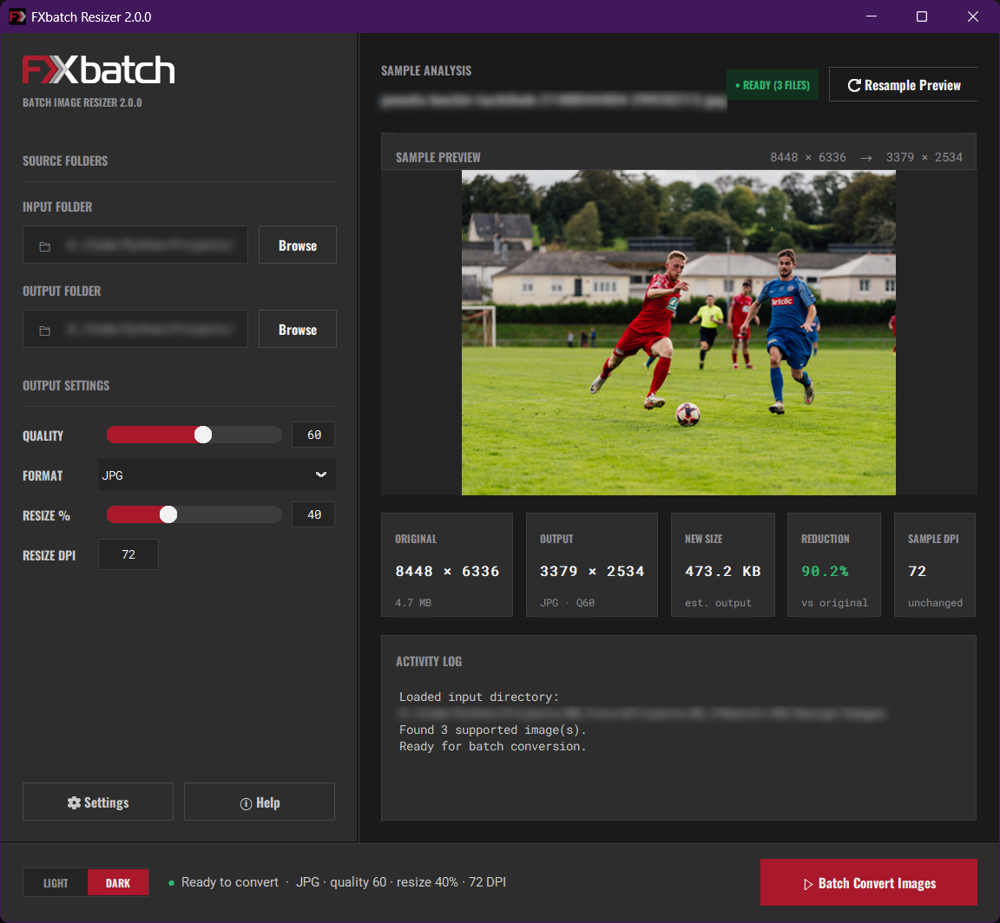
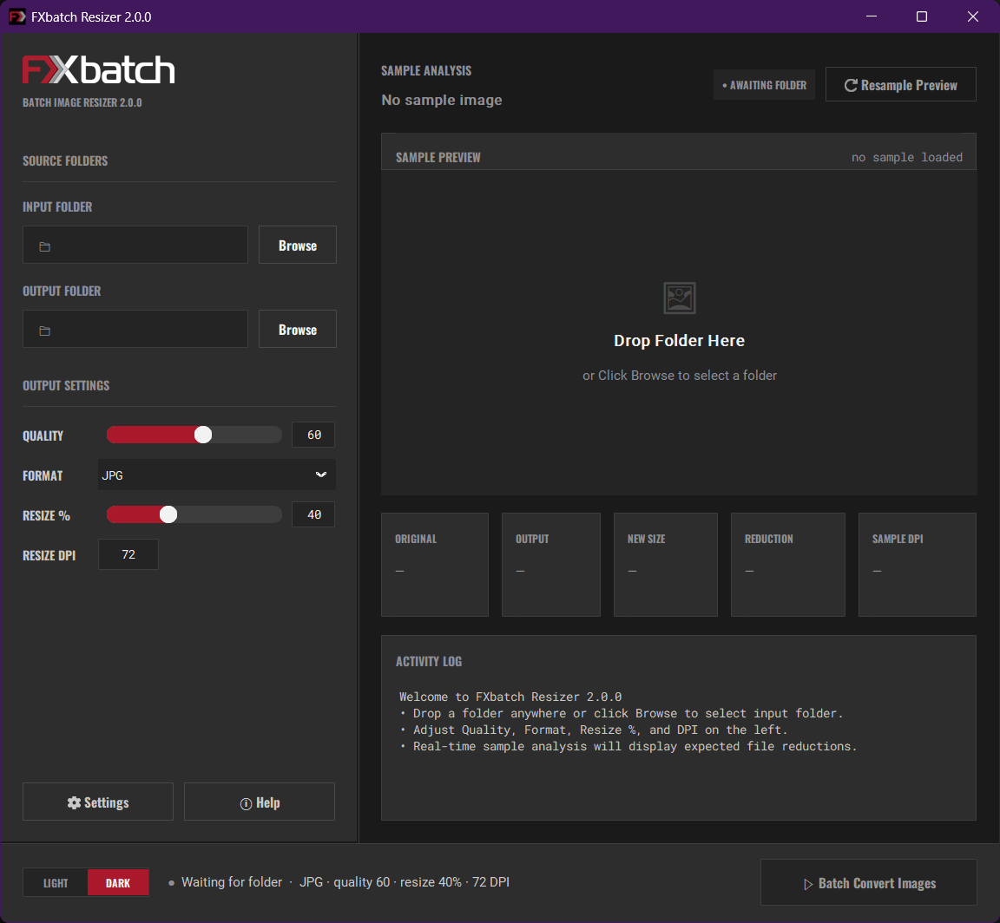
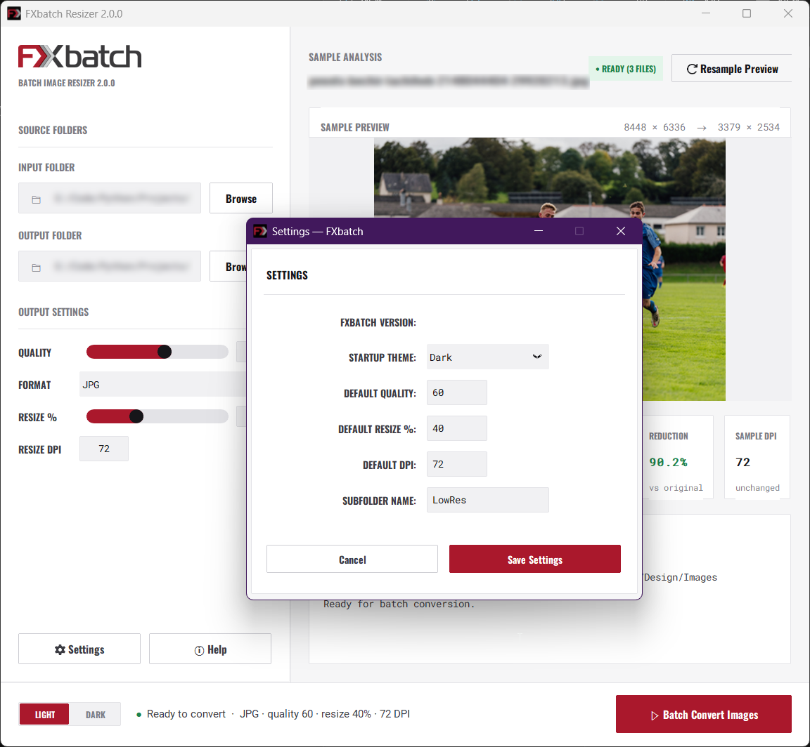

<div align="center">


# FXbatch Resizer 2.0.0

Batch image resizer and optimizer for desktop.

[](https://www.python.org/)
[](https://github.com/astral-sh/uv)
[](https://customtkinter.tomschimansky.com/)
[](https://python-pillow.org/)
[](LICENSE)

</div>

## Overview

<div align="center">
  
  <p><em>Sample preview, in-memory compression estimation, and multi-core processing log.</em></p>
</div>

FXbatch Resizer 2.0.0 is a desktop tool for bulk downscaling, DPI adjustment, and format conversion. It uses Python's multiprocessing pool to run conversions in parallel across all CPU cores while keeping the interface responsive.

## Features

### Processing engine
- Distributes work across logical CPU cores with Python's multiprocessing pool.
- Queues UI updates through a 20 ms polling loop on the main thread so the interface never freezes during long runs.
- Includes a 2.5-second warmup curve on the progress bar while worker processes spin up.

### Live sample analysis
- Estimates output file size and compression percentage in memory using Pillow BytesIO buffers, without writing temporary files to disk.
- Five cards show original resolution, target resolution, estimated file size, savings percentage, and DPI.
- Previews the first image in the folder with Lanczos resampling.

### Output controls
- Quality (10 to 100) and resize scale (10% to 100%) can be adjusted by slider or typed directly into numeric fields.
- DPI resampling from 72 to 3000 DPI.
- Supports JPEG, PNG, and WebP. Transparent areas in PNG or RGBA files are flattened onto a white background when saving to JPEG.

### Interface
- Dark mode and light mode with an option in Settings to choose the startup theme.
- Drag and drop folders directly into the dropzone, or select them with the system file picker.
- Terminal-style log with real-time progress and a summary banner on completion that scrolls to the top automatically.
- Settings window to configure default quality, resize percentage, DPI, and output subfolder name (default: `LowRes`).

## Screenshots

| Empty state | Settings dialog (light mode) |
|:---:|:---:|
|  |  |
| *Folder dropzone with quick tips.* | *Default values and theme preferences.* |

## Quick start

### With uv (recommended)

1. Clone the repository:
   ```bash
   git clone https://github.com/FXcodez/FXbatch.git
   cd FXbatch
   ```

2. Install dependencies:
   ```bash
   uv sync
   ```

3. Run the application:
   ```bash
   uv run fxbatch_main_gui.py
   ```

### With standard pip and venv

1. Clone the repository:
   ```bash
   git clone https://github.com/FXcodez/FXbatch.git
   cd FXbatch
   ```

2. Create and activate a virtual environment:
   ```bash
   # Windows
   python -m venv .venv
   .venv\Scripts\activate

   # macOS / Linux
   python3 -m venv .venv
   source .venv/bin/activate
   ```

3. Install dependencies:
   ```bash
   pip install customtkinter pillow tkinterdnd2 ctkmessagebox
   ```

4. Run the application:
   ```bash
   python fxbatch_main_gui.py
   ```

## How to use

1. Pick an input folder by dropping a folder into the dropzone or clicking Browse.
2. Choose an output format (JPEG, PNG, or WebP).
3. Set your target quality, resize percentage, and DPI.
4. Check the sample preview and estimated size reduction on the right.
5. Click Batch Convert Images. Converted files are saved in a `LowRes` folder inside your input directory.

## Project structure

```
FXbatch/
├── Design/
│   ├── Images/                # Sample test images
│   ├── Logos/                 # Brand icons and vector assets
│   └── Screenshots/           # Interface screenshots
├── fonts/                     # Bundled fonts (Oswald, Roboto, Roboto Mono)
├── icons/                     # Application icons (.ico, .png, .icns)
├── .gitignore                 # Excludes environments, build outputs, and cache
├── config.ini                 # Saved defaults and preferences
├── ConsolidatedChanges.md     # Architecture notes and version history
├── fxbatch_main_gui.py        # Main application window and settings dialog
├── help.html                  # Built-in help documentation
├── image_compressor.py        # Multiprocessing conversion engine
├── LICENSE                    # MIT License
├── pyproject.toml             # Project dependencies and packaging metadata
├── README.md                  # Project documentation
├── ui_preview.py              # Standalone interface preview
├── uv.lock                    # Dependency lockfile
└── widgets.py                 # CustomTkinter components and layout helpers
```

## Requirements

- Python >= 3.12
- CustomTkinter
- Pillow
- TkinterDnD2
- uv (optional, for project management)

## License

MIT License. See [LICENSE](LICENSE) for details.

## Author

FXcodez (LalFX)
Contact: lalxxl@gmail.com
