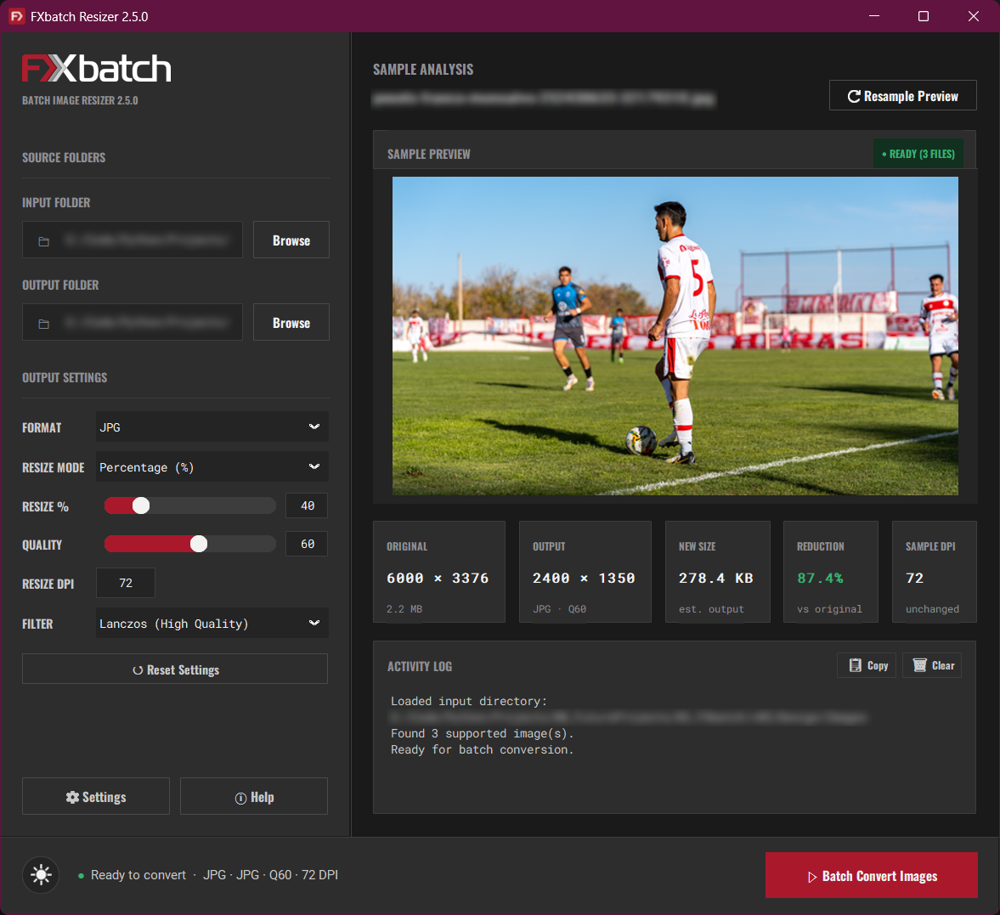
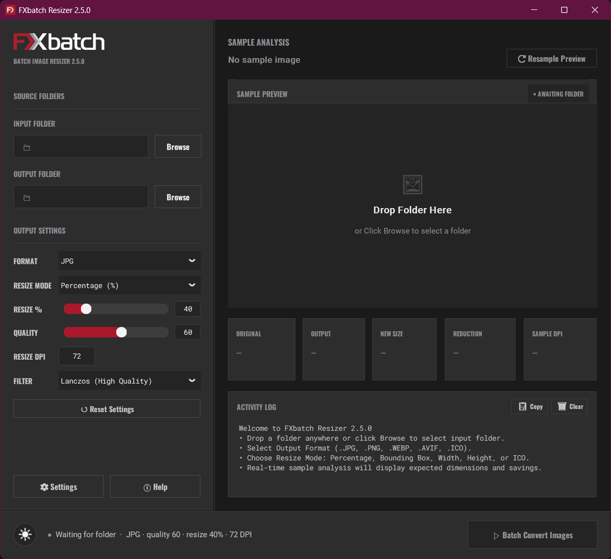
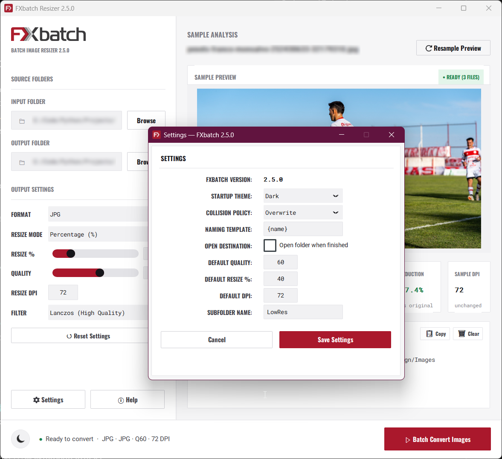

<div align="center">


# FXbatch 2.5.0

Batch image resizer, optimizer, and Windows icon converter.

[](https://www.python.org/)
[](https://github.com/astral-sh/uv)
[](https://customtkinter.tomschimansky.com/)
[](https://python-pillow.org/)
[](LICENSE)

</div>

## Overview

<div align="center">
  
  <p><em>Folder dropzone, sample preview, size estimates, and multiprocessing log.</em></p>
</div>

FXbatch is a desktop application for resizing, converting, and optimizing large folders of images. It distributes tasks across all available CPU cores using Python's multiprocessing pool, processing thousands of files quickly while keeping the interface responsive.

## What's New in Version 2.5.0

- **Output folder safety**: Conversions are blocked if the input and output directories match, protecting source images from accidental overwrites.
- **Sizing modes**: In addition to percentage scaling (5% to 200%), you can scale by bounding box (fit within max width and max height), fixed width (proportional height), or fixed height (proportional width).
- **Interpolation filters**: Choose between Lanczos, Bicubic, Bilinear, or Nearest Neighbor.
- **Windows icon creation (.ico)**: Convert photos and graphics into Windows icons. Exports single sizes (16, 32, 48, 64, 128, 256 px) or a multi-resolution package with all six sizes. Non-square source images are detected automatically and cropped to a 1:1 center ratio to avoid distortion.
- **AVIF format support**: Read and export AVIF images alongside JPEG, PNG, WebP, and ICO. Transparent areas in PNG, WebP, AVIF, and ICO files are preserved.
- **File collision handling**: Select how existing output files are handled in Settings (Overwrite, Auto-Rename with a numeric suffix, or Skip Existing).
- **Custom filename patterns**: Use dynamic tokens such as `{name}`, `{w}`, `{h}`, `{quality}`, and `{format}` to structure output filenames.
- **Explorer shortcut**: An "Open Output Folder" button appears after batch completion for quick access to converted files.
- **Interface updates**: Circular theme toggle button, descriptive mouseover tooltips for all settings fields, a reset-to-defaults button in Settings, and an updated activity progress display.

## Features

### Parallel processing
- Uses all logical CPU cores via Python's multiprocessing pool.
- Background progress updates poll on a 20 ms timer on the main thread to ensure the window remains responsive during long batches.
- Progress bar includes a 2.5-second warmup simulation while worker processes initialize.

### In-memory sample preview
- Generates live size and compression estimates using Pillow BytesIO buffers without writing temporary files to disk.
- Telemetry cards display original resolution, target resolution, estimated file size, savings percentage, and DPI.
- Previews the first image in the selected folder with high-quality resampling.

### Output controls
- Quality scale from 10 to 100 with direct numeric input or slider controls.
- Output resolution scaling via percentage (5% to 200%), bounding box, fixed width, or fixed height.
- DPI resampling from 72 to 3000 DPI.
- Formats: JPEG, PNG, WebP, AVIF, and ICO. Transparent PNG, WebP, and AVIF images are flattened onto a white background when saving to JPEG.

### Settings and preferences
- Set default quality, resize parameters, DPI, output subfolder, collision policy, and filename pattern.
- Choose startup theme (System, Dark, or Light).
- Preferences are saved locally to `config.ini`.

## Performance

FXbatch runs conversions concurrently across CPU cores.

### Benchmark example

Tested on an internal NVMe SSD with default settings (Quality: 60, Resize: 40%, Format: JPEG):

| Metric | Result |
|:---|:---|
| **Batch size** | 1,000 images |
| **Input resolution** | 5760x3840 px (22 MP) |
| **Output resolution** | 2304x1536 px (40% scale) |
| **Elapsed time** | ~20.7 seconds |
| **Throughput** | ~48 images/sec |

*Processing speeds vary based on CPU core count, disk read/write speed, and image dimensions.*

## Screenshots

| Startup screen | Settings dialog (light mode) |
|:---:|:---:|
|  |  |
| *Folder dropzone with quick tips.* | *Configuration options, collision policies, and naming tokens.* |

## Installation and Downloads

Pre-built binaries for 64-bit Windows are available on the [Releases](https://github.com/FXcodez/FXbatch/releases) page:
- **Windows Installer**: `FXbatch-2.5.0-Setup.exe` (setup wizard with desktop and Start Menu shortcuts)
- **Portable ZIP**: `FXbatch-2.5.0-Portable.zip` (extract and run `FXbatch.exe`, no installation needed)

### Running from source with uv (recommended)

1. Clone the repository:
   ```bash
   git clone https://github.com/FXcodez/FXbatch.git
   cd FXbatch
   ```

2. Run the application:
   ```bash
   uv run python fxbatch_main_gui.py
   ```

### Running with standard pip and venv

1. Clone the repository:
   ```bash
   git clone https://github.com/FXcodez/FXbatch.git
   cd FXbatch
   ```

2. Create and activate a virtual environment:
   ```bash
   # Windows
   python -m venv .venv
   .venv\Scripts\activate

   # macOS / Linux
   python3 -m venv .venv
   source .venv/bin/activate
   ```

3. Install dependencies:
   ```bash
   pip install customtkinter pillow tkinterdnd2 pillow-avif-plugin
   ```

4. Run the application:
   ```bash
   python fxbatch_main_gui.py
   ```

### Building the standalone executable

To compile the standalone Windows executable using PyInstaller:
```bash
uv run pyinstaller FXbatch.spec
```

The compiled application folder will be created in `dist/FXbatch/`.

## License

This project is licensed under the MIT License. See [LICENSE](LICENSE) for details.

## Author

[FXcodez](https://github.com/FXcodez)
