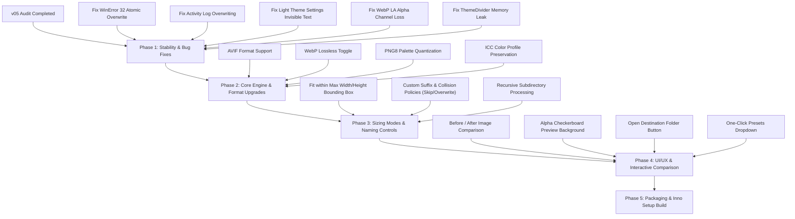

# FXbatch v06 — Comprehensive Code Analysis, Bug Audit & Feature Roadmap

**Date:** October 17, 2026  
**Audited Target:** FXbatch v05 (`g:\Code\Python\Projects\00_FutureProjects\03_FXbatch\v05`)  
**Output Target:** FXbatch v06 (`g:\Code\Python\Projects\00_FutureProjects\03_FXbatch\v06`)  
**Scope:** Architecture, Code Quality, Bug Audit, Performance, Security/Concurrency, User Experience, and Feature Enhancements.

---

## Table of Contents
1. [Executive Summary](#1-executive-summary)
2. [Codebase Architecture Overview](#2-codebase-architecture-overview)
3. [Deep-Dive Code Audit & Potential Issues](#3-deep-dive-code-audit--potential-issues)
   - [3.1 Critical Severity Issues](#31-critical-severity-issues)
   - [3.2 High & Moderate Severity Issues](#32-high--moderate-severity-issues)
   - [3.3 Minor & Polish Issues](#33-minor--polish-issues)
4. [Feature Analysis & Recommended Improvements for v06](#4-feature-analysis--recommended-improvements-for-v06)
   - [4.1 Advanced Resizing & Dimension Modes](#41-advanced-resizing--dimension-modes)
   - [4.2 Next-Gen Image Formats & Compression Intelligence](#42-next-gen-image-formats--compression-intelligence)
   - [4.3 Color Management & EXIF Metadata Preservation](#43-color-management--exIF-metadata-preservation)
   - [4.4 File Safety, Overwrite & Naming Patterns](#44-file-safety-overwrite--naming-patterns)
   - [4.5 Interactive UI, Visual Comparison & UX Polish](#45-interactive-ui-visual-comparison--ux-polish)
   - [4.6 One-Click Presets & Quick Profiles](#46-one-click-presets--quick-profiles)
   - [4.7 Packaging, Build & Deployment Refinements](#47-packaging-build--deployment-refinements)
5. [v06 Implementation Roadmap](#5-v06-implementation-roadmap)

---

## 1. Executive Summary

FXbatch v05 established a robust foundation by combining:
- A modern CustomTkinter dark/light design system with hardware-rendered dividers and custom brand typography (Oswald, Roboto, Roboto Mono).
- An asynchronous UI event dispatching queue (`Queue` + 20ms Tkinter polling) to avoid Python 3.12/3.13 cross-thread UI deadlocks.
- A multi-core batch image processing pipeline powered by Python's `multiprocessing.Pool` and Pillow.
- Fast offline user documentation (`help.html`) and Inno Setup distribution configuration.

However, a meticulous audit of the v05 codebase reveals several **critical edge-case bugs**, **concurrency risks**, **UI/UX disconnects**, and **missing industry-standard batch processing features**. Addressing these issues in **v06** will elevate FXbatch from a utility script into a commercial-grade, resilient image processing suite.

---

## 2. Codebase Architecture Overview

The v05 project consists of the following components:

| Component | File | Responsibilities | Key Dependencies |
| :--- | :--- | :--- | :--- |
| **Main GUI Entry Point** | `fxbatch_main_gui.py` (1,331 lines) | Application lifecycle, event loop, TkinterDnD integration, Settings window, UI dispatching queue, warmup animation ticker, batch runner thread. | `customtkinter`, `tkinter`, `tkinterdnd2`, `CTkMessagebox` |
| **Widget Construction** | `widgets.py` (996 lines) | Layout definitions, styling color tokens, `ThemeDivider` frame, sidebar controls, analysis metric cards, action bar, slider input validation. | `customtkinter`, `ctypes`, `PIL` |
| **Processing Engine** | `image_compressor.py` (217 lines) | Multiprocessing batch pool, Pillow Lanczos resizing, alpha flattening for JPEG, RAM estimator (`BytesIO`), folder scanning. | `multiprocessing`, `PIL (Image, ImageOps, ImageFile)` |
| **Configuration** | `config.ini` (12 lines) | Persistent user defaults (quality, resize %, DPI, batch folder name, startup theme, version). | `configparser` |
| **Standalone Prototype** | `ui_preview.py` (1,185 lines) | Standalone visual prototype used for UX verification. | `customtkinter`, `PIL` |
| **Packaging & Spec** | `FXbatch.spec`, `installer.iss` | PyInstaller onedir packaging and Inno Setup Windows installer compiler. | `PyInstaller`, `Inno Setup` |

---

## 3. Deep-Dive Code Audit & Potential Issues

### 3.1 Critical Severity Issues

#### Issue 1: Windows File Lock Crash on Same-Folder Overwrite (`PermissionError: [WinError 32]`)
- **File:** `image_compressor.py` (`compress_and_resize_image`, lines 56–77) & `fxbatch_main_gui.py` (lines 774–784)
- **Problem:** When a user sets the output folder to match the input folder (which FXbatch allows after an overwrite prompt), `compress_and_resize_image` opens the source file:
  ```python
  with Image.open(input_path) as img:
      ...
      img.save(output_path, ...)
  ```
  On Windows, Pillow keeps the underlying file handle open inside the `with Image.open(input_path)` block. When saving directly to `output_path` (where `output_path == input_path`), Windows prohibits writing to a file currently locked by an open read handle. This triggers:
  `PermissionError: [WinError 32] The process cannot access the file because it is being used by another process`
  Every single file in the batch fails with an error.
- **Solution for v06:**
  Implement safe atomic writing:
  1. Write the compressed file to a temporary file in the destination directory: `temp_output = output_path + f".tmp_{os.getpid()}_{time.time_ns()}"`.
  2. Exit the `with Image.open(...)` context manager to ensure the source file handle is completely closed.
  3. Atomically rename/replace using `os.replace(temp_output, output_path)`.

---

#### Issue 2: Activity Log Single-Line Overwrite Glitch
- **File:** `fxbatch_main_gui.py` (`_on_worker_progress`, lines 869–875)
- **Problem:** During active batch conversion, `_on_worker_progress` executes:
  ```python
  status_line = (
      f"Processing {current_idx}/{total_files} ({progress * 100:.0f}%) "
      f"• {rate:.1f} img/s • ETA: {eta:.1f}s — {filename}\n"
  )
  self.log_text.delete("1.0", "end")
  self.log_text.insert("end", status_line)
  ```
  Notice line 873: `self.log_text.delete("1.0", "end")` deletes the **entire** activity log content on every single image update!
  - Initial directory loading notices and startup greetings are instantly wiped.
  - Intermediate error messages for corrupted files are deleted before the user can read them.
  - The Activity Log card (which is 172px tall with active scrollbars) displays only one transient line instead of an actual scrolling log.
- **Solution for v06:**
  - Route the live telemetry (rate, ETA, current percentage) into the dedicated status line in the Action Bar or a pinned summary bar.
  - Use the Activity Log to append completed items:
    ```
    [10:14:02] [OK] photo_001.jpg (4.2 MB → 412 KB, -90.2%)
    [10:14:03] [WARN] logo_flat.png: No alpha found, saved as RGB.
    [10:14:04] [FAIL] damaged.jpg: Invalid SOS marker - corrupted file.
    ```
  - Limit the log buffer to 500 lines to prevent memory bloat, with auto-scroll following the latest entry.

---

#### Issue 3: Settings Window Invisible Version Number in Light Theme
- **File:** `fxbatch_main_gui.py` (`SettingsWindow.create_widgets`, line 1130)
- **Problem:**
  ```python
  ver_lbl = ctk.CTkLabel(
      self.card,
      text=APP_VERSION,
      font=ctk.CTkFont(family=MONO_FONT, size=11, weight="bold"),
      text_color="#FFFFFF",
      anchor="w",
  )
  ```
  The version number label explicitly sets `text_color="#FFFFFF"`. In Light Theme, `self.card` uses `COLOR_SURFACE` which resolves to `#FFFFFF`. Pure white text rendered over a pure white card surface results in a completely invisible version label.
- **Solution for v06:**
  Replace `text_color="#FFFFFF"` with dynamic theme token `text_color=COLOR_TEXT` (resolves to `#16161A` in Light and `#F2F2F2` in Dark) or use the brand accent `text_color=COLOR_BRAND`.

---

#### Issue 4: WebP Mode Drops Transparency on Grayscale/LA Images
- **File:** `image_compressor.py` (`_prepare_image_for_format`, lines 37–43)
- **Problem:**
  ```python
  elif fmt == "webp":
      if img.mode in ("RGB", "RGBA"):
          return img
      if img.mode == "P":
          return img.convert("RGBA" if "transparency" in img.info else "RGB")
      return img.convert("RGB")
  ```
  If an image has mode `LA` (Grayscale with Alpha channel, common in exports from Photoshop, GIMP, and Figma), it skips the `if` checks and executes line 42: `return img.convert("RGB")`.
  This completely destroys the alpha channel! WebP natively supports alpha transparency. The converted WebP loses its transparent background and replaces it with black or arbitrary artifacts.
- **Solution for v06:**
  ```python
  elif fmt == "webp":
      if img.mode in ("RGBA", "LA") or (img.mode == "P" and "transparency" in img.info):
          return img.convert("RGBA")
      return img.convert("RGB")
  ```

---

#### Issue 5: `ThemeDivider` Memory Leak in CustomTkinter AppearanceModeTracker
- **File:** `widgets.py` (`ThemeDivider`, lines 71–83)
- **Problem:**
  ```python
  class ThemeDivider(tk.Frame):
      def __init__(self, master, height: int = 1, width: int | None = None, color: tuple[str, str] = COLOR_BORDER, **kwargs):
          super().__init__(master, height=height, width=width or 1, bd=0, highlightthickness=0, **kwargs)
          self.color_tuple = color
          ctk.AppearanceModeTracker.add(self._on_theme_change)
          self._on_theme_change(ctk.get_appearance_mode())
  ```
  `AppearanceModeTracker.add` registers `self._on_theme_change` in a static global list. When windows with dividers are closed (such as `SettingsWindow` or dynamically replaced frames), `self._on_theme_change` is never removed.
  Each time the Settings window is opened and closed, dead callback references accumulate. Switching themes later invokes callbacks on destroyed Tkinter frames, triggering `TclError: bad window path name`.
- **Solution for v06:**
  Override `destroy()` on `ThemeDivider`:
  ```python
  def destroy(self):
      try:
          ctk.AppearanceModeTracker.remove(self._on_theme_change)
      except Exception:
          pass
      super().destroy()
  ```

---

#### Issue 6: Missing `tkinterdnd2` Dynamic Libraries in PyInstaller Spec
- **File:** `FXbatch.spec` (lines 15–19)
- **Problem:**
  ```python
  datas += collect_data_files('tkinterdnd2')
  ```
  `collect_data_files` collects Tcl scripts and pkgIndex files, but omits native compiled binaries (`tkdnd` shared libraries / DLLs such as `libtkdnd2.9.4.dll`).
  When built on a developer machine, the app may work if Python/Tcl is installed system-wide. On a clean client machine without Python, launching the frozen binary can crash with `TclError: cannot load library tkdnd` as soon as drag-and-drop initializes.
- **Solution for v06:**
  Add `from PyInstaller.utils.hooks import collect_dynamic_libs`:
  ```python
  binaries += collect_dynamic_libs('tkinterdnd2')
  ```

---

### 3.2 High & Moderate Severity Issues

#### Issue 7: Color Profile & EXIF Stripping Causes Washed-Out Colors
- **File:** `image_compressor.py` (`compress_and_resize_image`, lines 56–77)
- **Problem:**
  When images are opened, Pillow reads color profile data into `img.info["icc_profile"]`. During `img.save(...)`, `icc_profile` is omitted.
  Modern photos taken with iPhones, Android devices, or modern DSLRs are captured in **Display P3** or **Adobe RGB**. When saved without an ICC profile, standard image viewers and web browsers assume the sRGB color space. This results in **noticeably dull, desaturated, or shifted colors**.
  Additionally, all camera EXIF data (orientation, copyright, lens metadata) is stripped unconditionally.
- **Solution for v06:**
  - Preserve embedded ICC profiles when available:
    ```python
    icc = img.info.get("icc_profile")
    if icc:
        save_kwargs["icc_profile"] = icc
    ```
  - Alternatively, provide an automated sRGB transform via `PIL.ImageCms` so web images always render with accurate colors across all displays.
  - Add a configurable toggle: `[x] Preserve EXIF Metadata`.

---

#### Issue 8: Settings Window DPI Range Discrepancy
- **File:** `fxbatch_main_gui.py` (`SettingsWindow.create_widgets`, line 1175) vs `ImageCompressorApp.validate_dpi` (line 495)
- **Problem:**
  The main GUI validates DPI as `1 <= DPI <= 3000`.
  However, in `SettingsWindow`:
  ```python
  self.create_setting_row("DEFAULT DPI:", self.dpi_var, 6, 72, 3000, "dpi", width=70)
  ```
  The minimum value is hardcoded to `72`. If a user enters `50` or `60` DPI (standard for certain digital displays), the Settings window forcibly clamps it to `72`.
- **Solution for v06:**
  Harmonize minimum DPI across the entire app to `1` (or `10`).

---

#### Issue 9: Multiprocessing Pool Teardown Resource Warnings
- **File:** `image_compressor.py` (`process_images_in_folder`, lines 165–185)
- **Problem:**
  ```python
  with multiprocessing.Pool(processes=num_cores) as pool:
      for i, res in enumerate(pool.imap_unordered(...)):
          ...
  ```
  In Python 3.12+, leaving the `with multiprocessing.Pool` context without calling `pool.close()` and `pool.join()` causes `Pool.__exit__` to call `pool.terminate()`. On Windows, abruptly terminating worker processes that are in the middle of teardown generates `ResourceWarning` and occasional `BrokenPipeError` in the stderr log.
- **Solution for v06:**
  Explicitly call `pool.close()` and `pool.join()` upon loop completion:
  ```python
  if cancel_event and cancel_event.is_set():
      pool.terminate()
  else:
      pool.close()
  pool.join()
  ```

---

#### Issue 10: Premature Tk Initialization Side Effect at Import Time
- **File:** `widgets.py` (`_resolve_fonts`, lines 30–36)
- **Problem:**
  ```python
  def _resolve_fonts():
      try:
          r = tk.Tk()
          r.withdraw()
          avail = set(r.tk.call("font", "families"))
          r.destroy()
      except Exception:
          avail = set()
  ```
  `_resolve_fonts()` is invoked at top-level module import!
  Creating and immediately destroying a `tk.Tk()` instance before `customtkinter.CTk()` is instantiated interferes with CustomTkinter's internal Tcl interpreter state and can break TkinterDnD registration. Additionally, if `widgets.py` is ever imported in worker subprocesses, this spawns an unwanted GUI window handle.
- **Solution for v06:**
  Do not create a temporary Tk instance at import time. Check font availability after the main `ctk.CTk()` window is created, or pass the initialized root into font resolution.

---

#### Issue 11: Drag-and-Drop Mutation of Widget Inheritance Hierarchy
- **File:** `fxbatch_main_gui.py` (`_deferred_init_dnd`, lines 337–340)
- **Problem:**
  ```python
  if not hasattr(t, "drop_target_register"):
      t.__class__.__bases__ += (TkinterDnD.DnDWrapper,)
  ```
  Mutating `__class__.__bases__` dynamically at runtime causes Python Method Resolution Order (MRO) instability and metaclass warnings, especially with complex CustomTkinter wrapper widgets.
- **Solution for v06:**
  Bind directly to the underlying Tkinter peer (`widget._entry` or `widget._canvas`) using standard `TkinterDnD.dnd_start` or register via `self.tk.call("tkdnd::drop_target", "register", ...)`.

---

#### Issue 12: Fast Pasting Bypasses Input Folder Validation
- **File:** `fxbatch_main_gui.py` (`process_images`, lines 749–770)
- **Problem:**
  `validate_input_folder` is bound to `<FocusOut>` and `<Return>`. If a user pastes a folder path into the input entry with Ctrl+V and immediately clicks `▷ Batch Convert Images`, `<FocusOut>` has not fired yet.
  `self.image_files` remains unpopulated or points to the previously selected directory.
- **Solution for v06:**
  At the very beginning of `process_images()`, explicitly check:
  ```python
  if self.input_folder_path.get().strip() != self.previous_input_folder:
      self.validate_input_folder()
  ```

---

### 3.3 Minor & Polish Issues

#### Issue 13: Cancel Button Re-click Spam
- **File:** `fxbatch_main_gui.py` (`cancel_processing`, lines 840–850)
- **Problem:** Clicking "Cancel" does not disable the cancel button. A user can spam-click it, adding repeated `CANCELLING BATCH CONVERSION...` lines to the activity log.
- **Solution for v06:** Immediately disable `self.cancel_button` and update its label to `"Cancelling..."`.

---

#### Issue 14: Slider Dragging Fires High-Frequency Tkinter Updates
- **File:** `widgets.py` (`_create_slider_row`, line 461)
- **Problem:**
  `variable.trace_add("write", lambda *args: input_var.set(str(variable.get())))`
  While slider change updates are debounced by 350ms, setting `input_var` fires on every micro-step of slider motion, forcing the Tkinter text entry to re-render repeatedly during drags.
- **Solution for v06:** Only update `input_var` if `input_var.get() != str(val)`.

---

#### Issue 15: Fixed 540x300 Thumbnail Doesn't Resize with Window
- **File:** `fxbatch_main_gui.py` (`_load_and_cache_sample`, line 628)
- **Problem:** Thumbnail dimensions are hardcoded to `(540, 300)`. When the user maximizes the window or resizes above 920x820, the preview card expands, but the thumbnail image remains small, leaving large empty gray bars.
- **Solution for v06:** Bind `<Configure>` on `preview_card` to dynamically rescale the preview thumbnail to fit the actual available width and height while maintaining aspect ratio.

---

#### Issue 16: Inno Setup Desktop Shortcut Default
- **File:** `installer.iss` (line 36)
- **Problem:** `Flags: unchecked` means the desktop shortcut is disabled by default during installation. Most end-users expect a desktop shortcut to be checked by default.
- **Solution for v06:** Change to `Flags: checkedonce` or remove `unchecked`.

---

## 4. Feature Analysis & Recommended Improvements for v06

### 4.1 Advanced Resizing & Dimension Modes

Currently, FXbatch only supports uniform scaling via a single percentage slider (`10% – 100%`). This is a major limitation for professional workflows.

#### Proposed v06 Resize Modes:
1. **Percentage Scaling (`5% – 200%`)**:
   - Extends upper limit to allow quick 2× upscaling (useful for icons and low-res assets).
2. **Fit within Bounding Box (`Max Width × Max Height`)**:
   - Downscales images proportionally so neither dimension exceeds specified bounds (e.g. `1920 × 1080` for web presentations).
   - Preserves original aspect ratio with zero distortion.
3. **Fixed Width (Proportional Height)**:
   - Sets exact output width (e.g. `1200 px`), computing height automatically.
4. **Fixed Height (Proportional Width)**:
   - Sets exact output height (e.g. `800 px`), computing width automatically.
5. **Exact Dimensions with Fit Strategy**:
   - Allows user to choose behavior when aspect ratio differs:
     - **Pad / Letterbox**: Adds background color margins (black, white, or transparent).
     - **Crop to Fill**: Centers and crops excess edges.
     - **Stretch**: Non-uniform scaling (for specific display matrices).
6. **Resampling Filter Selector**:
   - `LANCZOS`: Standard photographic downsampling (default).
   - `BICUBIC`: Balanced interpolation.
   - `BILINEAR`: Faster throughput.
   - `NEAREST`: Essential for pixel art, sprites, and retro game textures.

---

### 4.2 Next-Gen Image Formats & Compression Intelligence

| Format | Current Status (v05) | Proposed for v06 | Benefit |
| :--- | :--- | :--- | :--- |
| **JPEG** | Quality slider (10–100), Baseline | Add **Progressive JPEG** toggle (`progressive=True`). | Progressive loading on web; ~2–3% smaller size. |
| **PNG** | Only lossless RGBA/RGB | Add **Quantization (PNG8 / 256 colors)** mode using `img.quantize(colors=256)`. | Up to **70% file size reduction** for web illustrations and UI screenshots while preserving alpha transparency. |
| **WebP** | Only lossy WebP (`quality=quality`) | Add **Lossless WebP toggle** (`lossless=True`). | Superior replacement for PNG with flawless edge clarity and 25% smaller size. |
| **AVIF** | Not supported | Add **AVIF export** (`.avif`) via Pillow + `pillow-heif` / `libavif`. | Next-generation image format offering **30–50% better compression** than JPEG and WebP at equivalent visual fidelity. |

---

### 4.3 Color Management & EXIF Metadata Preservation

1. **Embedded ICC Profile Retention**:
   - Read and write `icc_profile` across JPEG, PNG, and WebP.
   - Eliminates color shifts and dullness on wide-gamut displays (Apple Display P3, Adobe RGB).
2. **Automatic sRGB Color Conversion**:
   - For web-targeted conversions, convert CMYK and wide-gamut photos into standard sRGB before encoding.
3. **Configurable Metadata Toggle**:
   - Settings option: `[x] Strip Metadata for Web (Privacy & Smallest Size)` vs `[ ] Preserve Camera EXIF & Copyright`.

---

### 4.4 File Safety, Overwrite & Naming Patterns

1. **Atomic File Overwriting (Fix for WinError 32)**:
   - Always write to a temporary file (`.fxbatch_tmp`) and perform atomic replacement (`os.replace`) upon handle release.
2. **Custom Output Naming Patterns**:
   - Token-based naming options:
     - `{name}` — Original filename (`photo.jpg`)
     - `{name}_{w}x{h}` — Dimensions suffix (`photo_1920x1080.jpg`)
     - `{name}_q{quality}` — Quality suffix (`photo_q75.jpg`)
     - `{prefix}_{name}_{suffix}` — Custom user strings.
3. **Collision Policy Selection**:
   - **Auto-rename duplicates** (`photo_1.jpg`) — default.
   - **Overwrite existing files** — with safe atomic replace.
   - **Skip existing files** — enables resuming interrupted 10,000-image batches without re-encoding existing outputs.
4. **Subdirectory Recursion Option**:
   - Checkbox: `[x] Process Subdirectories Recursively`.
   - Replicates folder hierarchy in the output directory.

---

### 4.5 Interactive UI, Visual Comparison & UX Polish

1. **Before / After Comparison View**:
   - In the Preview Card, add a segmented view toggle: `[ Original ] | [ Converted ]` or an interactive horizontal split slider to compare visual quality and compression artifacts side-by-side.
2. **Alpha Checkerboard Background**:
   - For transparent PNG and WebP files, render a subtle two-tone checkerboard pattern (`#202020` / `#282828` in dark, `#E0E0E0` / `#FFFFFF` in light) under the preview thumbnail so transparent borders and dark logos are distinctly visible.
3. **Multi-line Terminal Activity Log**:
   - Real-time scrolling event feed showing processing milestones, per-image savings, warnings, and errors.
   - Includes quick utility buttons: `[ 📋 Copy Log ]` and `[ 🗑 Clear ]`.
4. **Direct "Open Output Folder" Action**:
   - When batch completes, display a prominent button `[ 📂 Open Destination Folder ]` that opens Windows Explorer directly to the output directory.
5. **Dynamic Window Resizing Preview**:
   - Bind `<Configure>` on the preview card to continuously rescale the thumbnail to fill available space smoothly.

---

### 4.6 One-Click Presets & Quick Profiles

Add a **Preset Selector** dropdown at the top of the Configuration Sidebar:
- **Web Optimized (Default)**: JPEG 75%, 50% scale, 72 DPI, strip metadata.
- **Social Media (Instagram/LinkedIn)**: Fit to 1080px max box, JPEG 85%, 72 DPI.
- **Lossless Archive**: WebP Lossless / PNG, 100% scale, preserve ICC & EXIF.
- **Ultra-Compact Email**: JPEG 50%, 40% scale, 72 DPI.
- **High-Res Print**: 100% scale, 300 DPI, preserve ICC & EXIF.
- **Custom**: Automatically selected whenever a slider or format dropdown is tweaked.

---

### 4.7 Packaging, Build & Deployment Refinements

1. **PyInstaller Spec Upgrade**:
   - Bundle `binaries += collect_dynamic_libs('tkinterdnd2')` to prevent missing DLL crashes.
   - Exclude unnecessary testing packages (`scipy`, `matplotlib`, `unittest`) to keep onedir size under 45 MB.
2. **Inno Setup Enhancements**:
   - Default desktop shortcut to checked.
   - Add file association option: Right-click any folder in Windows Explorer → `Open with FXbatch`.

---

## 5. v06 Implementation Roadmap



### Next Steps for Implementation:
1. **Initialize `v06` Codebase**: Clone clean source files from `v05/` into `v06/`.
2. **Execute Phase 1 Bug Fixes**: Apply atomic temp-file replace, fix activity log line deletion, update settings text colors, and patch WebP LA transparency.
3. **Integrate Advanced Engine (Phase 2 & 3)**: Add bounding box calculation, ICC retention, PNG quantization, and collision policies.
4. **Upgrade CustomTkinter Interface (Phase 4)**: Implement presets dropdown, comparison toggle, and open-folder button.
5. **Test & Package (Phase 5)**: Run test conversions with corrupted images, large folders (1,000+ files), test PyInstaller freeze, and generate installer.
